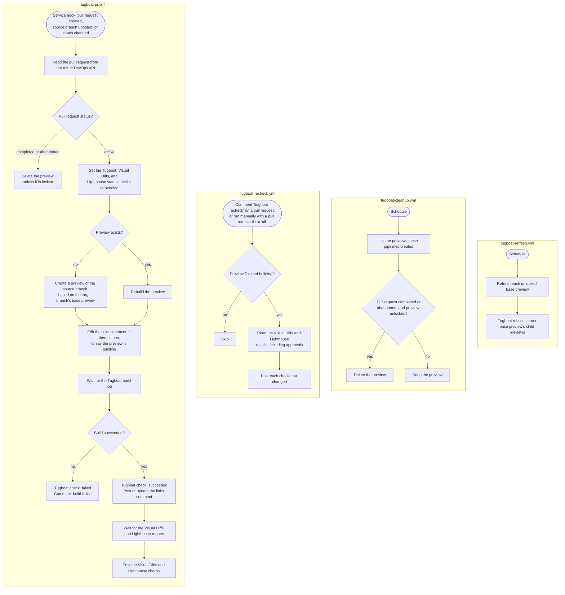

# Tugboat Azure DevOps Test

This repository is a reference setup for using Tugboat with a repository hosted in Azure Repos. Tugboat has no Azure DevOps integration, so Azure Pipelines calls the Tugboat API to provide the same pull request automation that Tugboat provides for GitHub, GitLab, and Bitbucket:

- Opening a pull request creates a Tugboat preview.
- Pushing commits to a pull request rebuilds its preview.
- Completing or abandoning a pull request deletes its preview. A scheduled cleanup deletes any previews this misses.
- A scheduled refresh updates the base previews and rebuilds their child previews.
- Each pull request gets a comment with links to the preview's services, the Tugboat dashboard, and Visual Diffs.
- Each pull request gets three status checks: `Tugboat`, `Tugboat - Visual Diffs`, and `Tugboat - Lighthouse Reports`.
- Commenting `/tugboat recheck` on a pull request updates the Visual Diffs and Lighthouse status checks after someone approves a failed report in the Tugboat dashboard.

The site itself is a single static page (`index.html`) served by Apache, as configured in `.tugboat/config.yml`.

## How it works

| File | Runs when | What it does |
| --- | --- | --- |
| `.azure-pipelines/tugboat-pr.yml` | An Azure DevOps service hook reports that a pull request was created, received commits, or changed status | Reads the pull request from the Azure DevOps API. If it is active, creates or rebuilds its preview, posts or updates the links comment, waits for the build, Visual Diffs, and Lighthouse reports, and posts the status checks. If it is completed or abandoned, deletes its preview unless the preview is locked. |
| `.azure-pipelines/tugboat-recheck.yml` | Someone comments `/tugboat recheck` on a pull request, or runs the pipeline manually with a pull request ID or `all` | Reads the current Visual Diffs and Lighthouse results, including approvals, and updates any status check that changed. |
| `.azure-pipelines/tugboat-cleanup.yml` | On a schedule. The default `cron` value, `0 * * * *`, runs every hour. | Deletes previews whose pull request is completed or abandoned, except locked previews. |
| `.azure-pipelines/tugboat-refresh.yml` | On a schedule. The default `cron` value, `8 0 * * *`, runs daily at 00:08 UTC. | Refreshes each unlocked base preview and rebuilds its child previews. |
| `.azure-pipelines/scripts/` | Called by the pipelines | Bash scripts that use `curl` and `jq` to call the Tugboat and Azure DevOps APIs. |

The pipelines name each preview they create `Azure PR #<id>: <title>` and find it again by that name. Previews with other names, such as previews that people create in the Tugboat dashboard, are never changed or deleted.

## Setup

### 1. Azure DevOps

1. Create an organization and a project at https://dev.azure.com.
2. Push this repository to a new repository in **Repos**. Use `main` as the default branch.
3. Enable pipeline runs, using one of:
   - **Organization settings > Billing**: link an Azure subscription. This enables the free Microsoft-hosted tier.
   - **Project settings > Agent pools**: register a self-hosted agent, then change `pool:` in each pipeline file to that pool.

### 2. Tugboat

1. In Tugboat, create a project and add a repository using the **Git** provider with the SSH clone URL from **Repos > Clone > SSH**.
2. Add the Tugboat repository's public SSH key in Azure DevOps under **User settings > SSH public keys**, as a user with read access to the repository.
3. Build a preview of `main` and set it as a base preview.
4. Create a Tugboat access token for the pipelines.

### 3. Permission to post status checks

1. Go to **Project settings > Repositories**, select the repository, and open **Security**.
2. Select **\<project name\> Build Service (\<organization name\>)**.
3. Set **Contribute to pull requests** to **Allow**.

### 4. Incoming webhooks

Create two service connections, one named `tugboat-pull-request` and one named `tugboat-pr-comment`. For each:

1. Go to **Project settings > Service connections > New service connection > Incoming WebHook**.
2. Set both **WebHook Name** and **Service connection name** to the name.
3. Select **Grant access permission to all pipelines** and save.

### 5. Pipelines

For each of `tugboat-pr.yml`, `tugboat-recheck.yml`, `tugboat-cleanup.yml`, and `tugboat-refresh.yml`:

1. Go to **Pipelines > New pipeline > Azure Repos Git**, select the repository, then **Existing Azure Pipelines YAML file**.
2. Select the file, then open the **Run** menu and select **Save**.
3. Azure names every new pipeline after the repository. Open the pipeline, select **⋮ > Rename/move**, and name it after the file, for example `tugboat-pr`.

### 6. Pipeline variables

1. Go to **Pipelines > Library** and create a variable group named `tugboat`.
2. Add `TUGBOAT_REPO` with the Tugboat repository ID.
3. Add `TUGBOAT_API_TOKEN` with the Tugboat access token. Select the lock icon to make it secret.
4. Save the variable group.
5. Open the **Pipeline permissions** tab, select **+**, and add each of the four pipelines.

For an on-premise Tugboat installation, also add:

- `TUGBOAT_API`: `https://api.<your Tugboat domain>/v3`
- `TUGBOAT_DASHBOARD`: `https://dashboard.<your Tugboat domain>`

### 7. Register the webhooks

1. Run `tugboat-pr` manually. The run fails with "Invalid pull request ID". This is expected; the run registers the webhook.
2. Run `tugboat-recheck` manually with the default `all`.

### 8. Service hooks

Go to **Project settings > Service hooks** and create four **Web Hooks** subscriptions for this repository:

| Trigger on this type of event | Change | URL ends with |
| --- | --- | --- |
| Pull request created | (none) | `/webhooks/tugboat-pull-request?api-version=6.0-preview` |
| Pull request updated | Source branch updated | `/webhooks/tugboat-pull-request?api-version=6.0-preview` |
| Pull request updated | Status changed | `/webhooks/tugboat-pull-request?api-version=6.0-preview` |
| Pull request commented on | (none) | `/webhooks/tugboat-pr-comment?api-version=6.0-preview` |

Each **URL** starts with `https://dev.azure.com/<organization name>/_apis/public/distributedtask`.

### 9. Optional: require status checks

1. Go to **Repos > Branches**, open the `main` branch menu, and select **Branch policies**.
2. Under **Status Checks**, add a required policy for each of:
   - `tugboat/Tugboat`
   - `tugboat/Tugboat - Visual Diffs`
   - `tugboat/Tugboat - Lighthouse Reports`
